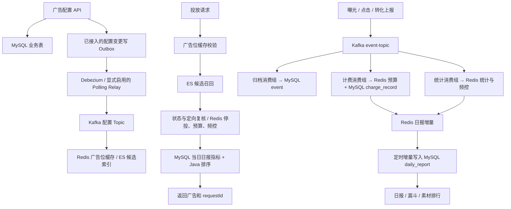

# 广告投放与实时数据分析平台

基于 Java 17、Spring Boot 和 Maven 的广告平台后端，围绕广告配置、候选召回、在线投放、事件采集、预算计费和效果报表组织业务。

项目的核心思路是：MySQL 保存业务数据，Elasticsearch 承担候选检索，Redis 保存预算消耗、频控与统计增量，Kafka 将事件处理和配置同步从请求链路中分离。

> 当前源码处于数据模型和基础设施重构过程中。2026-11-11 核对时，编译尚未通过，实体、查询与迁移脚本也存在不一致。本文区分代码中的业务流程与尚未接通的能力；启动前请先阅读「当前状态与限制」。

## 技术栈与目录

| 组件 | 仓库中的用途 |
| --- | --- |
| Java 17 / Spring Boot 3.3.5 | HTTP API、参数校验、依赖注入、事务与调度 |
| MyBatis-Plus 3.5.7 / MySQL | 业务配置、事件明细、计费流水、日报及 Outbox |
| Redis / Lua | 广告位与事件元数据缓存、预算控制、事件去重、频控、日报增量 |
| Spring Data Elasticsearch | 候选查询、索引重建、配置增量同步 |
| Spring Kafka / Debezium | 广告事件异步处理、MySQL Outbox CDC |
| Guava / Resilience4j | 本地布隆过滤器、依赖调用熔断 |
| MapStruct 1.5.5.Final / Lombok | 请求、实体与响应转换，以及模型样板代码 |
| Actuator / Micrometer / Prometheus / Grafana | 接口、消息处理和缓存指标 |
| Logback / Alloy / Loki | ERROR 日志采集与查询 |
| JUnit 5 / Mockito / Embedded Kafka / JMeter | 单元测试、集成测试与压测资源 |

```text
.
├── pom.xml
├── src/main/java/com/example/adplatform
│   ├── admin          # 广告主、广告位、计划、素材和定向规则管理
│   ├── delivery       # 投放请求、候选过滤与排序
│   ├── tracking       # 事件接入、归档、计费和统计
│   ├── report         # 日报、漏斗、素材排行及定时刷库
│   ├── search         # 候选模型、查询投影、索引管理入口和 Outbox
│   ├── health         # MySQL、Redis 健康检查
│   ├── common         # 统一响应、异常、公开 ID 和 MyBatis 配置
│   └── infra          # Redis、Kafka、ES、Debezium、布隆过滤器、熔断和预热
├── src/main/resources
│   ├── application.yml
│   ├── application-local.yml
│   ├── logback-spring.xml
│   ├── redis/scripts  # 预算扣费、事件统计、费用统计、日报快照 Lua
│   └── sql            # 建表、历史迁移和演示数据
├── src/test/java       # 按生产包结构组织的测试
├── docker              # Kafka、Debezium、Kafbat 和可观测性编排
├── jmeter              # JMX、压测数据准备与清理脚本
└── docs                # 项目说明和历史开发文档
```

业务域通过 `port` 接口访问基础设施是项目的分层方向，但当前部分业务类仍直接引用 `infra`，不能视为已经完全隔离。

## 核心业务链路

下图概括现有代码的职责与数据流，具体运行阻塞点见文末。



### 1. 广告配置

- **广告主**：创建、分页、更新和删除，作为计划和素材的归属主体。
- **广告位**：维护 `slotCode`、尺寸、场景和启停状态；投放请求通过广告位编码定位广告位。
- **广告计划**：配置总预算、日预算、出价、计费类型和投放时间，提供上线、暂停和下线操作。创建时校验广告主；暂停要求计划当前为 `ONLINE`。
- **素材**：当前创建请求使用 `advertiserPublicId`、`slotPublicId` 和 `name` 等字段，默认待审核。当前 Controller 未提供素材审核接口。
- **定向规则**：当前管理接口按 `planPublicId` 维护地域、设备、性别、年龄和标签条件；这部分接口仍保留旧模型，与后续关联表迁移尚未统一。

API 使用 `adv_`、`slot_`、`plan_`、`mat_`、`rule_` 前缀的公开标识。预算、出价和事件计费金额在现有业务逻辑中使用整数，单位为分。

### 2. 在线投放

入口为 `POST /api/delivery/ads`，主要编排位于 [AdDeliveryServiceImpl](../src/main/java/com/example/adplatform/delivery/service/impl/AdDeliveryServiceImpl.java)。

1. 生成 `requestId`，查询启用中的广告位。广告位缓存先访问 Redis，再通过本地布隆过滤器、分段锁和 MySQL 回源处理未命中。
2. 默认 `FAIL_CLOSED` 策略下，广告位 Redis 异常或熔断会返回空广告结果；广告位不存在则返回业务错误。
3. 通过 `CandidateRecallPort` 调用 ES 召回。查询构造器包含广告位、时间、地域、设备、性别、年龄和标签条件，默认召回 200 条、配置硬上限 1000 条。
4. 编排代码继续复核候选状态、时间和定向，再批量查询 Redis 停投集合、计划预算消耗和用户频控。
5. 从 MySQL `daily_report` 批量读取计划当日曝光、点击数据，在 Java 中排序后返回 Top N。默认返回 3 条，请求范围为 1～10 条。

当前排序公式为：

```text
CTR = 无曝光时取 0.02，否则取 min(点击数 / 曝光数, 1)
score = bidPrice × 0.7 + CTR × 1000 × 0.2 + 50 × 0.1
```

同分时按素材内部 ID 降序排列。频控阈值为同一用户、同一计划、同一天 5 次真实曝光，计数由事件统计消费者更新，因此不是投放请求次数限制，也不是同步曝光预占。

**降级边界：**仓库保留了 `CandidateRecallService` 和 `MysqlCandidateRecallService`，但当前投放入口直接调用 `EsRecallServiceImpl`，没有经过该降级编排。不能依赖“ES 故障自动回源 MySQL”，也不能用 `ELASTICSEARCH_ENABLED=false` 作为已验证的纯 MySQL 投放模式。

### 3. 事件接入与三路消费

入口为 `POST /api/tracking/events`，支持 `IMPRESSION`、`CLICK`、`CONVERSION`。

事件 API 将消息写入 `event-topic`，以 `eventId` 为 Kafka Key。专用 Producer 使用 `acks=all`、幂等发送、批处理及 LZ4 压缩，并在 Broker 确认后完成异步 HTTP 响应。成功只表示 Kafka 已接收，归档、计费和统计仍由后台处理。

| 默认消费组 | 职责 | 幂等机制 |
| --- | --- | --- |
| `event-archive-consumer` | 写入 MySQL `event` 明细 | `event_id` 唯一键 |
| `event-billing-consumer` | 判断计费事件、检查预算、写 `charge_record`、累计费用 | Redis 扣费决定 + 流水唯一键 + 独立费用统计去重 |
| `event-statistics-consumer` | 累加曝光、点击、转化，更新曝光频控 | Redis Lua 原子去重与累加 |

三个消费组独立推进，不能假定归档先于计费或统计完成。事件统计与费用统计的 Redis 去重窗口均为 14 天；它们不是无限期的端到端 Exactly Once 保证。

计费代码中的规则：

| 类型 | 触发条件 |
| --- | --- |
| CPC | 点击事件按 `bidPrice` 扣费 |
| CPA | 转化事件按 `bidPrice` 扣费 |
| CPM | 曝光事件读取 MySQL 当日计划曝光数，当 `(曝光数 + 1) % 1000 == 0` 时扣费 |

预算 Lua 在一次执行中检查日预算、总预算，累加已消耗金额并记录事件扣费结果；预算不足时流水记录为 `BUDGET_EXHAUSTED`。缓存缺失时，预算服务从成功计费流水恢复消耗值。

CPM 当前依赖异步刷新的日报曝光数，不是独立的原子千次曝光计数器，因此并发及统计延迟下的计费准确性仍需完善。

### 4. 报表与一致性

统计消费者通过 Lua 把事件去重、曝光频控及日报增量一起写入 Redis；计费消费者单独累计费用。默认每轮刷库结束后等待 10 秒，再处理当天的待落库统计。

刷库先用 Lua 取出并扣除快照，再对 `daily_report` 执行增量写入；捕获数据库异常时把快照恢复到 Redis。Redis 与 MySQL 不共享事务，进程在跨存储操作之间退出时没有完整的恢复闭环。

- **日报**：按日期查询，可选按计划过滤。
- **漏斗**：汇总日期范围内的曝光、点击、转化和消耗；`CTR = 点击 / 曝光`，`CVR = 转化 / 点击`，分母为 0 时返回 0。
- **素材排行**：按计划与素材聚合，依次按消耗、点击、曝光降序排列；默认 10 条，上限 50 条。

报表接口读取 MySQL，存在 Kafka 消费和定时刷库延迟。当前没有 `/api/report/realtime` 接口；调度任务只刷当天，历史日期事件及跨天残留增量还需要补刷机制。

### 5. 配置同步与索引维护

已接入的计划、规则和广告位变更会写入 `outbox_message`，与业务变更共同提交本地事务。素材 CRUD 当前没有相应 Outbox 调用，不能认为所有配置都能自动同步。

Outbox 有两种传输方式：

- `debezium`：默认方式，Kafka Connect 读取 MySQL Binlog，由 Event Router 按 Outbox 的 `topic` 字段路由消息。
- `polling`：通过 `OUTBOX_TRANSPORT=polling` 显式启用。应用默认每 500 ms 领取一批消息，收到 Kafka 确认后标记已发送；失败安排重试。切换时应停用对应 CDC 发布，避免两路同时转发。

当前配置包含 `ad-config-change`、`ad-slot-write`、`ad-slot-update`、`ad-slot-evict`、`ad-slot-es-sync`。配置同步采用有限重试与 DLT；广告位缓存消费者对指定的 Redis/数据库/熔断异常持续退避，其他异常进入 `ad-slot-cache-sync-dlt`。原始事件消费者未配置同等的专用 DLT 流程。

索引管理入口为 `POST /api/platform/search/candidates/rebuild`。实现创建 `ad-candidate-时间戳` 物理索引，批量写入、刷新后切换别名，Redis 锁用于协调重建。当前只切换读别名，首次无别名时的处理和写别名维护尚未完整；新文档模型也尚未与旧查询统一。

## 本地环境与启动

以下命令均在**仓库根目录**执行。它们说明仓库现有入口；当前阻塞项修复前，不代表完整环境可以直接启动成功。

### 依赖服务

| 服务 | 本地配置地址 | 提供方式 |
| --- | --- | --- |
| MySQL | `localhost:3306/ad_platform` | 自行准备，历史环境使用 MySQL 8 |
| Redis | `localhost:6379`，DB 0 | 自行准备 |
| Elasticsearch | `http://localhost:9200` | 自行准备；当前仓库没有 ES Compose 文件 |
| Kafka | `127.0.0.1:9092` | `docker/docker-kafka.yml` |
| Kafka Connect | `127.0.0.1:8083` | `docker/docker-debezium.yml` |
| Kafbat UI | `http://127.0.0.1:8084` | `docker/docker-kafbat.yml`，可选 |

Kafka Compose 定义 3 个独立 Controller 和 3 个 Broker，镜像为 `apache/kafka:4.3.1`，宿主机 Broker 端口为 `9092/9094/9096`。应用的 Topic 声明仍显式指定单副本，不能将这个拓扑理解为业务 Topic 已具备三副本容灾。

```bash
# 启动 Kafka；已有服务占用上述端口时先处理冲突
# Compose 会创建独立数据卷，不会自动迁移其他 Kafka 实例的数据
docker compose -f docker/docker-kafka.yml up -d

# 修正 Connector JSON 并配置 MySQL CDC 后，再启动 Connect
docker compose -f docker/docker-debezium.yml up -d

# 可选管理界面
docker compose -f docker/docker-kafbat.yml up -d
```

Debezium 与 Kafbat 使用 Linux host 网络访问本机服务。MySQL CDC 需要开启 Binlog，设置唯一 `server-id`、`binlog_format=ROW` 和 `binlog_row_image=FULL`，并准备 [07-debezium-cdc.sql](../src/main/resources/sql/07-debezium-cdc.sql) 中的账号权限。Compose 的初始化容器会注册 `ad-platform-outbox` Connector。

当前 Connector 使用 `snapshot.mode=no_data`，首次启动不会自动发送既有 Outbox 行。修改账号、地址时，需同时核对 [Connector 配置](../docker/debezium/outbox-connector.json)，它不会自动读取应用的 `MYSQL_*` 环境变量。

### 数据库脚本

项目未接入 Flyway 或 Liquibase；`schema_version` 是脚本登记表。SQL 目录同时包含旧版基线、存量迁移和新模型变更，**目前不存在已验证的“按文件名执行全部脚本即可运行”路径**。

| 脚本 | 内容与适用范围 |
| --- | --- |
| `00`、`01`、`02`、`04` | 建库、早期管理模型、投放关联字段、事件/计费/日报表 |
| `05`、`11` | 旧表名与字段名迁移，按现有数据库结构选择 |
| `06`、`07`、`08`、`09` | Outbox、CDC 权限、旧事件字段清理、公开标识 |
| `10`、`12` | 标签及用户相关表 |
| `13`、`14` | 计划与素材、规则关联表；迁移并删除旧关联字段及规则标签字段 |
| `15`～`18` | 公共字段、钱包与预算状态、地域关联、广告主助手相关表 |
| `19`～`21` | 表名改为单数、移除钱包币种、删除旧地域字段、设备字段转 JSON |
| `99` | 旧模型演示数据，包含删除现有业务数据的语句 |

例如，`14` 删除 `material.plan_id` 和 `rule.plan_id`，`20` 删除 `rule.region`，但部分 Mapper 和管理逻辑仍读写这些字段。`99` 仍插入旧字段，不能作为最新迁移后的初始化步骤。钱包等新增表也不能据此视为已经接入在线计费。

接入新环境前，应先统一当前实体、Mapper 与目标表结构，再生成或核验对应初始化脚本；存量库依据实际结构和 `schema_version` 选择迁移。不要直接在已有业务数据的库上运行 `99`。

### 应用配置

默认 Profile 为 `local`，API 端口为 `8080`，配置位于 [application-local.yml](../src/main/resources/application-local.yml)。

| 环境变量 | 默认值 / 作用 |
| --- | --- |
| `MYSQL_URL` | 本机 `ad_platform` JDBC URL，时区 `Asia/Shanghai` |
| `MYSQL_USERNAME` / `MYSQL_PASSWORD` | 本地默认 `root` / `123456` |
| `REDIS_HOST` / `REDIS_PORT` / `REDIS_DATABASE` | `localhost` / `6379` / `0` |
| `REDIS_PASSWORD` | 默认空 |
| `REDIS_CONNECT_TIMEOUT` / `REDIS_COMMAND_TIMEOUT` | `500ms` / `300ms` |
| `KAFKA_BOOTSTRAP_SERVERS` | `127.0.0.1:9092` |
| `ELASTICSEARCH_URIS` | `http://localhost:9200` |
| `ELASTICSEARCH_USERNAME` / `ELASTICSEARCH_PASSWORD` | 默认空 |
| `ELASTICSEARCH_ENABLED` | 默认 `true`，当前不能据此保证关闭后的投放降级 |
| `OUTBOX_TRANSPORT` | 默认 `debezium`，可选 `polling` |
| `SLOT_CACHE_FAILURE_POLICY` | 默认 `FAIL_CLOSED` |
| `LOG_PATH` | 默认 `logs` |

```bash
# 构建检查
mvn -DskipTests compile

# 编译和配置问题修复后启动
mvn spring-boot:run -Dspring-boot.run.profiles=local

# 打包并运行
mvn clean package
java -jar target/ad-platform-0.0.1-SNAPSHOT.jar --spring.profiles.active=local
```

启动预热依次尝试广告位、预算、事件元数据布隆过滤器和 ES 索引；单项失败会记录日志并继续。因此应用进程存活不等于所有业务链路可用。

## API 概览与示例

有业务参数的接口使用 JSON 请求体，删除接口也通过请求体传入 `publicId`。统一返回结构为：

```json
{"code":0,"message":"成功","data":null}
```

### 管理接口

下表每个前缀均有 `POST /create`、`POST /page`、`PUT /update`、`DELETE /delete`，例如创建广告主的完整路径是 `POST /api/platform/advertisers/create`。

| 路径前缀 | 资源 | 额外接口 |
| --- | --- | --- |
| `/api/platform/advertisers` | 广告主 | — |
| `/api/platform/slots` | 广告位 | `PUT /status` |
| `/api/advertiser/plans` | 广告计划 | `PUT /online`、`PUT /pause`、`PUT /offline` |
| `/api/advertiser/materials` | 素材 | — |
| `/api/advertiser/rules` | 定向规则 | — |

分页请求可传 `{"current":1,"size":10}`。当前分页 Service 主要执行排序分页，不应沿用旧文档中未接入的过滤能力。素材审核和规则 `/by-plan` 不在当前 Controller 路由中。

### 投放、事件与报表

| 方法 | 路径 | 作用 |
| --- | --- | --- |
| POST | `/api/delivery/ads` | 请求广告 |
| POST | `/api/tracking/events` | 上报曝光、点击、转化 |
| POST | `/api/report/daily` | 日报 |
| POST | `/api/report/funnel` | 日期区间漏斗 |
| POST | `/api/report/top-materials` | 素材排行 |
| POST | `/api/platform/search/candidates/rebuild` | 全量重建候选索引，无请求体；当前返回 `data: null` |
| GET | `/api/health` | MySQL、Redis 检查，需查看 `data.status` |
| GET | `/actuator/health` | Actuator 健康状态 |
| GET | `/actuator/prometheus` | Prometheus 指标 |

以下示例展示当前 DTO 契约，需在运行阻塞项处理、业务数据准备完成后执行。

```bash
curl -X POST http://127.0.0.1:8080/api/delivery/ads \
  -H 'Content-Type: application/json' \
  -d '{"viewerId":10001,"slotCode":"HOME_BANNER","region":"BEIJING","deviceType":"ANDROID","age":25,"gender":"MALE","tags":["shopping"],"size":3}'
```

投放响应的 `data` 包含 `requestId`、`totalCandidates`、`returnedCount` 和 `ads`。广告项包含计划、素材、广告位的公开标识，以及标题、描述、图片、落地页、出价和得分。

事件上报使用实际返回的 `materialPublicId` 和 `requestId`；下例标识仅为格式示例。相同事件重试应复用 `eventId`，不同事件应生成新的标识。

```bash
curl -X POST http://127.0.0.1:8080/api/tracking/events \
  -H 'Content-Type: application/json' \
  -d '{"eventId":"demo-impression-001","requestId":"req_replace_with_actual","eventType":"IMPRESSION","materialPublicId":"mat_00000000000000000000000000000001","viewerId":10001}'
```

`eventTime` 可省略；显式传入时使用 `2026-11-11T10:00:00` 形式。接入成功的响应示例：

```json
{
  "code": 0,
  "message": "成功",
  "data": {
    "eventId": "demo-impression-001",
    "eventType": "IMPRESSION",
    "duplicate": false,
    "billingType": null
  }
}
```

这里的 `duplicate: false` 是接入层固定响应，不代表消费者已完成重复检查，也不表示计费已完成。

```bash
# 日期按实际业务日期替换；publicId 为可选过滤字段
curl -X POST http://127.0.0.1:8080/api/report/daily \
  -H 'Content-Type: application/json' \
  -d '{"statDate":"2026-11-11"}'

curl -X POST http://127.0.0.1:8080/api/report/funnel \
  -H 'Content-Type: application/json' \
  -d '{"startDate":"2026-11-01","endDate":"2026-11-11"}'

curl -X POST http://127.0.0.1:8080/api/report/top-materials \
  -H 'Content-Type: application/json' \
  -d '{"startDate":"2026-11-01","endDate":"2026-11-11","limit":10}'
```

## 可观测性

```bash
docker compose -f docker/docker-log.yml up -d
```

| 入口 | 地址 |
| --- | --- |
| Grafana | `http://127.0.0.1:3000`，本地默认账号密码 `admin` / `admin` |
| Prometheus | `http://127.0.0.1:9090` |
| Loki | `http://127.0.0.1:3100` |
| Alloy | `http://127.0.0.1:12345` |

仓库提供 Kafka 事件链路和广告位缓存相关的 Dashboard、告警配置。重点关注 `ad.event.producer.*`、`ad.event.consumer.*`、`ad.slot.cache.*` 指标及各消费组 Lag。Exporter 的 Topic/Group 过滤条件仍含旧广告位同步名称，需要与当前拆分后的 Topic 对齐。

日志路径为 `Logback ERROR → logs/ad-platform-error.log → Alloy → Loki → Grafana`。默认只集中采集 ERROR；排查预热或重试问题时也应查看应用控制台。修改 `LOG_PATH` 后，需要同步调整 Alloy 的文件挂载。

## 测试与压测

```bash
# 默认测试
mvn test

# 搜索链路集成测试，显式执行
mvn -Dtest=SearchPipelineIT test
```

测试目录包含管理请求校验、CRUD、投放与定向匹配、事件三路处理、Kafka Producer、缓存并发与熔断、布隆过滤器、预热和架构边界等测试。

`SearchPipelineIT` 需要外部 MySQL、Redis、Elasticsearch，Kafka 使用 Embedded Kafka，并启用 Polling Outbox。它依赖固定演示计划，会修改计划状态和 Outbox，因此应使用独立测试环境；当前新旧模型不一致时也不能直接视为可用的验收脚本。

压测入口为 [jmeter/ad-platform-load-test.jmx](../jmeter/ad-platform-load-test.jmx)，说明见 [JMeter README](../jmeter/README.md)。其中部分数据 SQL、管理路由、重建响应及 ES 降级断言沿用旧模型，执行前需对齐当前实现。本文不提供未经当前版本验证的 QPS 或延迟成绩。

## 当前状态与限制

以下为 2026-11-11 根据源码与本地检查确认的主要问题，本次文档更新未修改业务代码或配置。

| 范围 | 当前情况 |
| --- | --- |
| 编译 | `mvn -o -DskipTests compile` 在 MapStruct 处理阶段报告 6 个错误，涉及 `ReportConverter`、`EventConverter`、`AdDeliveryConverter` 的源字段、目标字段不匹配；尚不能运行完整测试 |
| 数据模型 | 管理实体已调整部分公开标识与字段，旧 Mapper 仍使用数值关联、`bloomSnapshot`、`material.title` 等；迁移脚本又删除了部分旧查询所需字段 |
| ES | `CandidateDocument` 已改为组合标识及新定向字段，查询和投放代码仍引用旧字段；重建仅维护读别名，首次无别名分支也不完整 |
| ES 降级 | 降级类仍在仓库，但当前投放调用路径未接入 |
| 配置同步 | 素材 CRUD 未写 Outbox；不能把源码注释中的完整同步描述当作实际覆盖范围 |
| Kafka 配置 | `KafkaTopicConfig` 仍要求 `app.kafka.topics.slot-cache-sync`，当前本地 YAML 已拆为 write/update/evict，缺少该旧配置项 |
| Debezium | `outbox-connector.json` 的 `message_key` 配置行存在多余逗号，JSON 校验失败，初始化注册无法正常完成 |
| 计费与报表 | CPM 依赖异步日报；定时刷库只处理当天；跨 Redis/MySQL 的故障恢复不具备完整事务保证 |

修复上述问题后，需要重新验证编译、数据库初始化、索引重建及投放—事件—报表闭环，才能将启动步骤视为已验收流程。

[DEVELOPMENT.md](DEVELOPMENT.md) 保留历史阶段规划；[Debezium README](../docker/debezium/README.md) 保留 CDC 操作背景。它们与当前实现不一致的接口、路径和能力描述，以当前源码及本页注明的状态为准。
